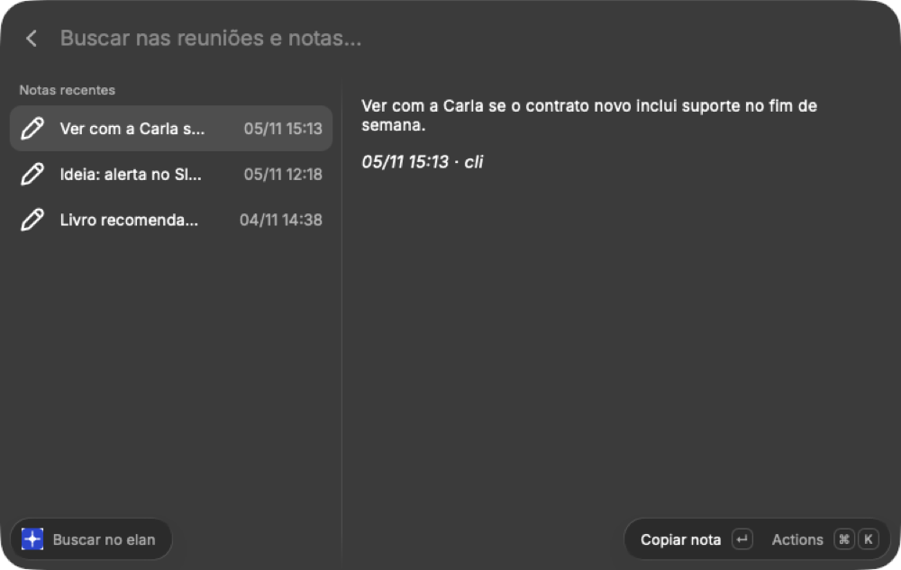
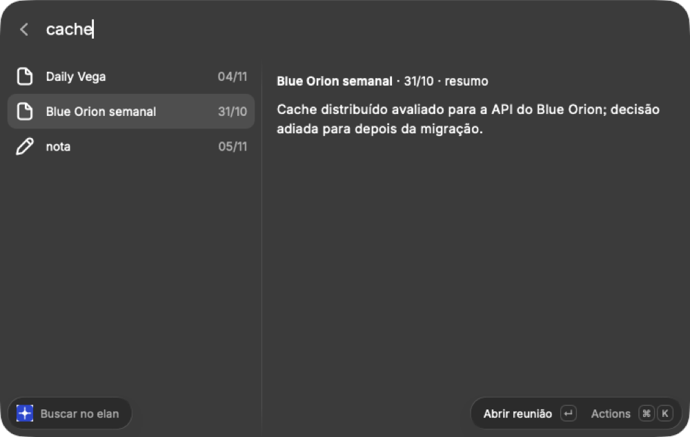
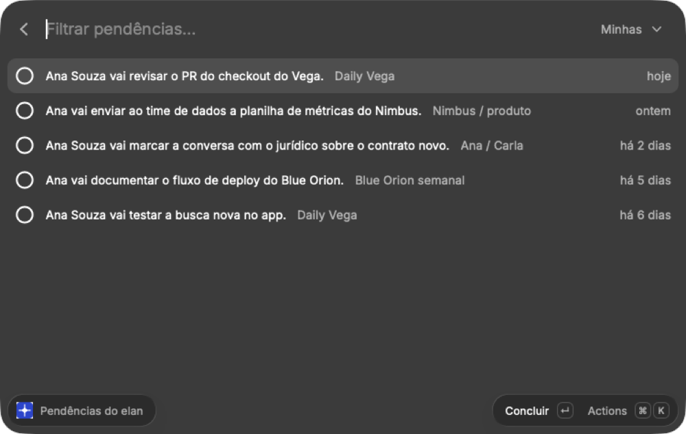

# elan

A personal work memory that runs on your Mac. elan reads the notes and
transcripts of your Google Meet meetings, turns each one into a summary,
decisions, action items and facts, and makes all of it searchable by Claude.
Around that: your Google Calendar agenda, Google Tasks, a daily briefing,
reminders before meetings, and frontends for [Herdr](https://herdr.dev),
[Rex](https://www.superlogical.com/rex) and [Raycast](https://www.raycast.com)
to start coding tasks with an agent.

Nothing leaves your machine except the calls to Google (your own data) and to
Claude Code (your subscription). The database is a local SQLite file and the
embeddings come from a local Ollama model.

> elan speaks Brazilian Portuguese: its interface, the distillation prompts,
> the briefing and the notifications are in pt-BR.

## What it does

- **Meetings:** syncs the `Google Meet` folder in Drive (Gemini notes and
  transcripts, including meetings other people organized) and distills each one
  with Claude: summary, decisions, action items with owners, and facts. New
  decisions mark older ones on the same topic as superseded.
- **Search:** hybrid (keyword + semantic), filtered by period and by person
  (with nicknames: "Beto" finds Roberto).
- **Action items:** each one is open, done or dropped. Later meetings can mark
  it as done; yours become Google Tasks, and completing it on one side completes
  it on the other.
- **Agenda:** each event of the day comes with the last meeting of the same
  series and what is still pending with you.
- **Daily briefing:** on workdays, at the time you choose, a page with the
  agenda, your pending items, what you are waiting on from others and recent
  decisions.
- **Reminders:** ~10 minutes before each meeting, with the summary of the
  previous one.
- **Code tasks:** coding tasks you create (or promote from an action item).
  "Start" creates a git worktree and opens Claude Code in it with the task and
  the meeting's context.
- **Notes:** `elan note "..."`, or "take a note that..." in Claude.

All of it is available to Claude Code / Claude Desktop through a local MCP
server.

## How it works

```
Google Drive (Meet) ─┐                       ┌─ MCP (Claude Code / Desktop)
Google Calendar ─────┤                       ├─ CLI `elan`
Google Tasks ────────┼─ elan daemon ─ SQLite ┼─ briefing (HTML) + notifications
Claude Code (-p) ────┤   (LaunchAgent)       ├─ Herdr mods, Rex (elan-rex)
Ollama (embeddings) ─┘                       └─ Raycast extension
```

The daemon runs every 30 minutes: it syncs meetings, distills the new ones,
updates the search index, exports your action items to Google Tasks and brings
back what you completed there. It also builds the briefing and sends the
reminders.

## Requirements

- macOS on Apple Silicon.
- Go 1.26+ and the Xcode command line tools (cgo, for SQLite).
- [Claude Code](https://claude.com/claude-code) installed and logged in
  (`claude` on the PATH). Distillation uses `claude -p` with your subscription.
- [Ollama](https://ollama.com) with the embedding model:
  ```sh
  brew install ollama && brew services start ollama
  ollama pull embeddinggemma
  ```
- A Google Workspace account where Meet saves Gemini notes and transcripts to
  Drive.
- Optional: [Herdr](https://herdr.dev) or [Rex](https://www.superlogical.com/rex)
  for the panel and code tasks; [Raycast](https://www.raycast.com) for the menu
  bar and search.

## Install

### 1. Build and install

```sh
git clone git@github.com:vitalbh/elan.git && cd elan
make install          # installs ~/.local/bin/elan
```

`~/.local/bin` must be on your PATH.

### 2. Google credentials (once)

In the [Google Cloud Console](https://console.cloud.google.com/), in a project
of your organization:

1. Enable the **Google Drive**, **Google Calendar** and **Google Tasks** APIs
   (`gcloud services enable drive.googleapis.com calendar-json.googleapis.com tasks.googleapis.com --project=<project>`).
2. In **APIs & Services → OAuth consent screen**, choose **Internal**. With
   External in testing mode, the token expires after 7 days.
3. In **Credentials**, create an **OAuth client ID** of type **Desktop app**
   and download the JSON.
4. Put the JSON in the profile directory:
   ```sh
   mkdir -p ~/Library/Application\ Support/elan/work
   mv ~/Downloads/client_secret_*.json ~/Library/Application\ Support/elan/work/google-credentials.json
   chmod 600 ~/Library/Application\ Support/elan/work/google-credentials.json
   ```
5. Log in (opens the browser):
   ```sh
   elan google-login
   elan drive-recent    # should list your recent files
   ```

### 3. Profile configuration

`~/Library/Application Support/elan/work/config.json` (everything is optional,
but without `owner.names` elan can't tell which action items are yours):

```json
{
  "owner": { "names": ["Your Full Name", "Nickname"] },
  "tasks": { "list": "elan · reuniões" },
  "briefing": { "at": "08:50" },
  "people": [["Roberto", "Beto"], ["Mariana", "Mari"]],
  "projects": {
    "Site": { "path": "~/Dev/site", "aliases": ["front"], "description": "web front end" },
    "API": { "path": "~/Dev/api", "base": "upstream/main" }
  },
  "base_remotes": ["upstream"]
}
```

| Field | What for |
|---|---|
| `owner.names` | how you appear in meetings; decides which action items are yours |
| `tasks.list` | the Google Tasks list where your action items are created |
| `briefing.at` | from when the day's briefing is generated (`HH:MM`) |
| `people` | groups of names of the same person, for search by person |
| `projects` | project name as it appears in meetings → repository folder; `base` is where a code task's branch starts |
| `base_remotes` | preferred remotes for the base branch when the project has no `base` |

### 4. First load

```sh
elan meetings sync              # downloads the meetings from Drive
elan meetings distill --limit=0 # distills all of them (uses your Claude subscription)
elan index                      # builds the search index
elan actions classify --limit=0 # marks which action items are code (suggestions)
elan briefing --open            # builds and opens today's briefing
```

Distillation takes ~30 s per meeting. If it hits the Claude usage limit, it
stops and says when it frees up; run it again later.

### 5. Daemon

```sh
elan service install   # LaunchAgent elan.work: starts at login, runs every 30 min
elan service status
tail -f ~/Library/Logs/elan/work.log
```

### 6. Claude (MCP)

```sh
claude mcp add elan -s user -- ~/.local/bin/elan mcp
```

In a new Claude Code session: "what was decided about X?", "what did Roberto
commit to?", "what's my briefing?", "create a code task in the API: ...",
"take a note that ...".

### 7. Herdr (optional)

```sh
make herdr-install
```

Installs the `elan` (panel) and `elan-window` (full window) mods. To open the
window with ⌘⇧E, add `"cmd-shift-e": "elan.open"` to the `global` section of
`~/.config/herdr-app/keys.json`. For the button in the top bar, see
[`herdr/README.md`](herdr/README.md).

### 8. Rex (optional)

```sh
make rex-install    # ~/.local/bin/elan-rex and ~/.config/rex/elan.lua
```

Add `require("elan")` to `~/.config/rex/init.lua`. ⌘⇧E opens the elan window
in a new tab (Today, Search, Code tasks, Suggestions, Pending); enter on a code
task creates the worktree and opens Claude Code in it. See
[`rex/README.md`](rex/README.md).

### 9. Raycast (optional)

```sh
cd raycast && npm install && npm run dev
```

The next meeting in the menu bar (with the day's agenda, pending items, code
tasks and recent notifications), plus **Buscar no elan** (search),
**Pendências do elan** (pending items) and **Anotar no elan** (take a note).
Code tasks open in Rex.

| Search (empty: recent notes) | Search | Pending |
|---|---|---|
|  |  |  |

The screenshots use made-up data: in the extension's preferences, set the elan
binary to `rex/demo/elan` and the data folder to `rex/demo/home`.

## Everyday use

| Command | What it does |
|---|---|
| `elan search "query" [--person=name] [--since=YYYY-MM-DD]` | searches meetings and notes |
| `elan agenda [--day=YYYY-MM-DD]` | agenda with the previous meeting of each series |
| `elan briefing [--open]` | the day's briefing |
| `elan actions pending [--owner=mine\|others]` | open action items |
| `elan action update <id> --status=done` | closes an action item |
| `elan codetasks` / `add` / `suggestions` / `promote` / `start` | code tasks |
| `elan note "text"` / `elan notes` | saves a note / lists the latest ones |
| `elan meeting <id>` | a meeting as Markdown |

Almost all of them accept `--json`; the contract is in
[`docs/cli-json.md`](docs/cli-json.md).

## Data and privacy

- Everything lives in `~/Library/Application Support/elan/<profile>/`: the
  SQLite database, the Google credentials and token (0600), briefings and
  events.
- Profiles keep contexts apart (`--profile=work`, `--profile=personal`): each
  has its own database, Google account and configuration.
- Meeting content goes through Claude Code on your subscription (distillation)
  and no other service; embeddings are local.

## Development

```sh
make build      # bin/elan
make test       # go test -race
make lint       # go vet
make herdr-check
make rex-build
```

Architecture decisions are in [`ARCHITECTURE.md`](ARCHITECTURE.md) and rules
for coding agents in [`AGENTS.md`](AGENTS.md) (both in Portuguese).
