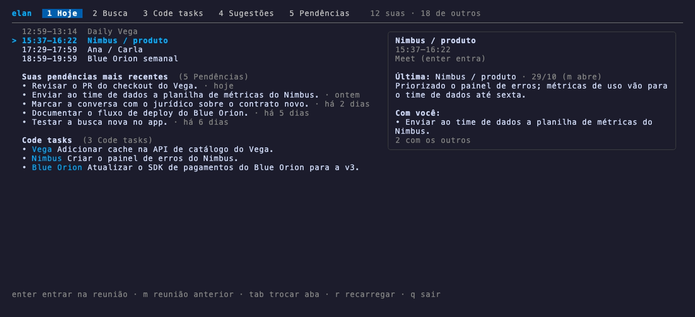
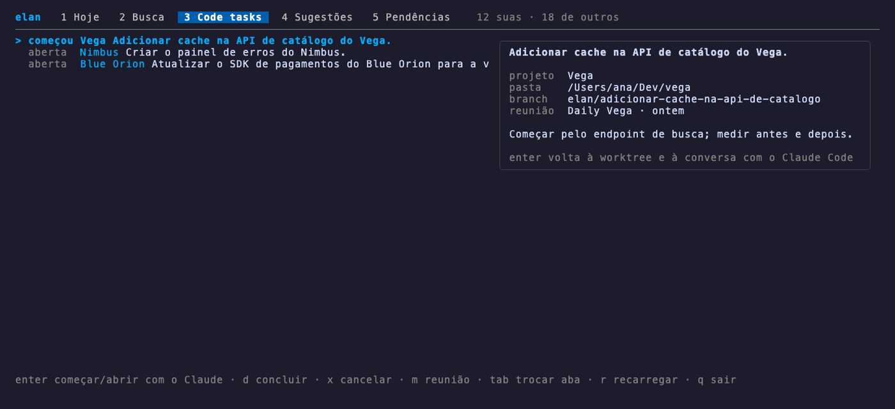
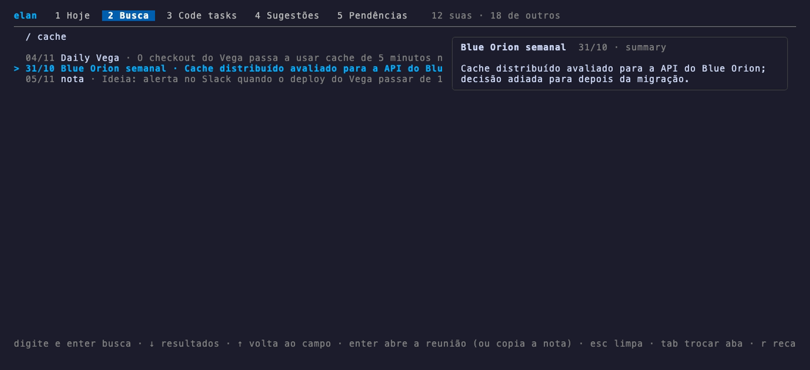
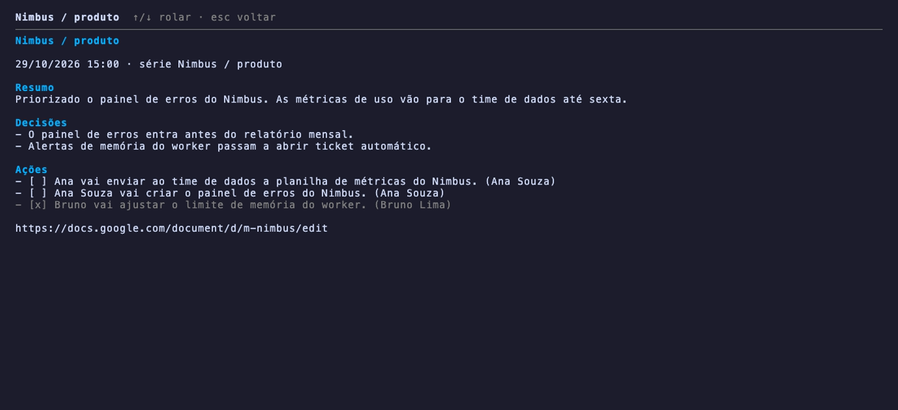
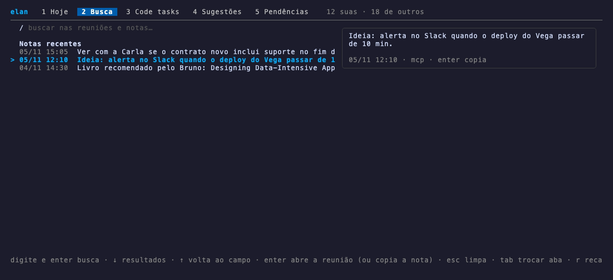
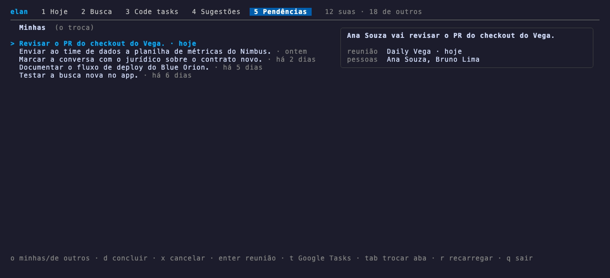

# elan in Rex

The elan frontend for the [Rex](https://www.superlogical.com/rex) terminal.
Like the Herdr mods (`../herdr`), it talks to elan only through the CLI with
`--json` (`docs/cli-json.md`); the code tasks' git worktree is made here.

- **⌘⇧E** opens the elan window in a new tab: **Hoje** (today's meetings with
  the previous one in each series and what is still with you, plus your latest
  pending items), **Busca** (search), **Code tasks**, **Sugestões**
  (suggestions) and **Pendências** (pending items, yours and others').
- **Code task → Claude:** enter on a code task turns the tab into the task: it
  creates the git worktree (the same place the Herdr mod uses,
  `~/.herdr/worktrees/<repo>/<branch>`, so a task started in one opens in the
  other) and runs `claude` with the task's prompt. The next time, it resumes
  the conversation (`claude --continue`).
- Actions in the Rex command palette: **elan: Abrir** (open), **elan: Buscar**
  (search) and **elan: Abrir code task (id)** (the one Raycast uses).

| Today | Code tasks |
|---|---|
|  |  |
| **Search** | **Meeting** (`m`) |
|  |  |
| **Recent notes** (empty search) | **Pending items** |
|  |  |

The screenshots use made-up data: `demo/elan` is a fake elan that answers the
CLI contract. To record them again: `rex/demo/record.sh` (needs
[VHS](https://github.com/charmbracelet/vhs)).

| key | |
|---|---|
| `1`–`5`, tab | switch tabs |
| `/` | search |
| enter | Today: join the meeting · Code tasks: start/open · Suggestions: make it a code task · Search/Pending: open the meeting (on a recent note: copy it) |
| `m` | open the meeting (Today: the previous one in the series) |
| `d` / `x` | done / drop (code task or pending item) |
| `o` | Pending: mine ↔ others' |
| `t` | Pending: open in Google Tasks |
| `r`, `q` | reload, quit |

In the search tab, ↓ moves into the results, ↑ on the first one goes back to
the field, and esc clears the field (or closes the window when it is empty).

## Install

```sh
make rex-install    # ~/.local/bin/elan-rex and ~/.config/rex/elan.lua
```

Then add `require("elan")` to `~/.config/rex/init.lua` and run
`rex config reload`.

`ELAN_BIN`, `ELAN_PROFILE` and `ELAN_HOME` change the elan binary (default:
`elan` on the PATH or `~/.local/bin/elan`), the profile (default `work`) and
the data folder.
